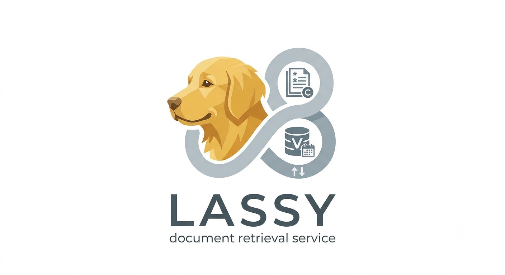

# Lassy
Lassy indexes supplied document text and returns relevant evidence with citations.
It uses local embeddings, PostgreSQL/pgvector hybrid search, publication recency,
and optional local cross-encoder reranking. It never generates answers or fetches
web pages. The calling application supplies text and authorizes document changes.

MCP hosts launch Lassy directly over **stdio**, like [Babar](../babar/README.md).
An optional HTTP API supports [Lalaland](../lalaland/README.md) and other HTTP
consumers. Both adapters call the same document service. There is no Bazel build,
VS Code extension, standalone MCP adapter, feedback service, or query-history store.

## Install and prepare

Use CPython **3.13.16**, `uv`, and an existing PostgreSQL 15+ database with pgvector:

```sh
uv sync --locked                     # Native MCP
# For HTTP and development checks:
uv sync --locked --extra api --extra dev
cp -n .env.template .env
# Edit database settings; use an absolute HF_HOME when launching from an MCP host.
export LASSY_ENV_FILE="$PWD/.env"
uv run --no-sync lassy-models prepare
```

Only `lassy-models prepare` downloads models. Runtime loads immutable snapshots
from the local cache, even if `HF_HUB_OFFLINE=0` is inherited. Defaults are
`sentence-transformers/all-mpnet-base-v2`, revision
`e8c3b32edf5434bc2275fc9bab85f82640a19130`, dimension 768. To enable reranking,
set `ENABLE_RERANKING=true` and run preparation again; its default snapshot is
`cross-encoder/ms-marco-MiniLM-L-6-v2` at
`233902d25c440f23af6f7d6e94d2946bac0bee0a`.

Initialize **only a new empty database** using your administrator connection:

```sh
psql -X -v ON_ERROR_STOP=1 --single-transaction -f db/init.sql YOUR_DATABASE
```

Existing installations must follow the [upgrade and model-identity adoption guide](docs/documents.md).
No startup command applies migrations, deletes history, or reindexes existing data.
Settings come from exported environment variables and an optional explicit
`LASSY_ENV_FILE`; no ambient `.env` is loaded. Never commit credentials.

## Connect an MCP host

Configure the host with absolute checkout/config/cache paths:

```json
{
  "servers": {
    "lassy": {
      "type": "stdio",
      "command": "/absolute/workspace/lassy/.venv/bin/python",
      "args": ["-m", "lassy.mcp"],
      "env": {
        "LASSY_ENV_FILE": "/absolute/private/lassy.env",
        "HF_HOME": "/absolute/cache/huggingface"
      }
    }
  }
}
```

The package must be installed in that interpreter. Supply only necessary database
and model configuration; use a restricted runtime database role. Hosts authorize
writes and treat document text as untrusted evidence. Collection filters are
logical scopes, not multi-user authorization. MCP does not provide OS isolation.
Each host process loads its own models; size memory limits accordingly.

Tools:

- `lassy_status()` checks index readiness and reports model identity.
- `search_knowledge_base(query, top_k=5, filters=null)` returns ranked `chunks`
  with citations, provenance, scores, and transient timing.
- `upsert_document(collection, document_id, document)` atomically creates/replaces
  supplied text, title, URL provenance, publication date, metadata, and sections.
- `delete_document(collection, document_id)` removes a document and its chunks.

Upserts are idempotent; metadata-only changes reuse vectors. Document locks span
preparation and publication across separate MCP/API processes. Busy operations
return a retryable error; indexing yields between bounded inference batches.
There is no MCP HTTP/SSE endpoint or dependency on `local-mcp-server`.

## Optional HTTP API

Install the `api` extra, prepare the models, and run:

```sh
LASSY_ENV_FILE="$PWD/.env" uv run --no-sync lassy-api
```

The example `.env` binds to loopback port 8082. Without overrides, native defaults
remain loopback port 8000. Routes are `/health`, `/query`, document PUT/DELETE,
and `/docs`. [HTTP contracts](docs/api.md) describe limits and responses.

Compose remains available for standalone HTTP deployments:

```sh
# In .env set POSTGRES_HOST=host.docker.internal, API_PORT=8082.
# Prepare into the bind-mounted cache before startup.
HF_HOME="$PWD/.cache/huggingface" LASSY_ENV_FILE="$PWD/.env" uv run --no-sync lassy-models prepare
docker compose up -d --build lassy
```

For the existing Argo-managed installation, use [image releases](docs/releases.md).
[local-agent-environment](../local-agent-environment/README.md) owns runtime
provisioning, cache mapping, recovery, and service access. Lalaland retains its
existing HTTP address and document/query integration. A Compose rebuild does not
update Argo's selected image.

## Verification

```sh
uv sync --locked --extra api --extra dev
uv run --no-sync ruff check lassy tests
uv run --no-sync pytest -q
# Creates/drops uniquely named lassy_test_* databases only:
LASSY_TEST_POSTGRES=1 uv run --no-sync pytest -q
```

Integration tests use synthetic content/models and default to an administrator
connection of `postgresql:///postgres`; set `LASSY_TEST_ADMIN_DSN` if needed.
See [development and dependency audits](docs/development.md),
[document migration](docs/documents.md), [model cache](docs/model-cache.md),
and [deployment](docs/setup.md). Python dependencies are defined solely by
`pyproject.toml` and `uv.lock`.
